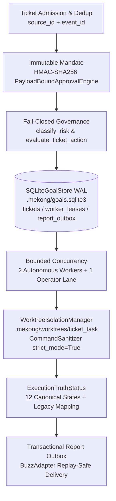

# Plan: Mekong CLI — Autonomous Runtime Convergence (Supreme Command #01)

## Overview

Unify Durable Tickets, Immutable Mandates, Fail-Closed Governance, Crash-Recoverable Worker Leases, Transactional Report Outbox, and Git Worktree Worker Isolation (`max_autonomous_workers=2` + `1` `OPERATOR_CONTROL` lane) directly into `SQLiteGoalStore` (`.mekong/goals.sqlite3`, WAL mode), `GoalEngine`, and `MekongCoreRuntimeImpl` while eliminating all P0 false-positive execution truth defects (`H1`–`H7`).

This plan implements the verified winning architecture (`Candidate E` — `77/80`, `unanimous=yes`, `margin=high`) from `/Users/macbook/plans/reports/advise-261101-1857-mekong-autonomous-runtime-convergence.md`, incorporating the `kongming` verifier's exact path and risk-map enhancements (`src/mekongcli/core/execution/local_executor.py:43` and `src/core/governance.py:103,206`).

## Architecture & Flow

## Phases

| Phase | Title | Status | Priority | Dependencies | Related Files | Validation Gate |
|---|---|---|---|---|---|---|
| [Phase 01](./phase-01-forensic-audit-and-execution-truth.md) | Forensic Audit & P0 Execution Truth (`G0`–`G1`) | completed | P1 | None | `docs/audits/MEKONG_AUTONOMOUS_RUNTIME_RESTRUCTURE_2026-11-01.md`, `src/mekongcli/core/goal_engine/models.py`, `src/mekongcli/core/goal_engine/service.py`, `src/mekongcli/core/verification/gates.py`, `src/core/runtime_adapter.py`, `src/core/adapters/goal_engine_adapter.py` | `pytest -q tests/mekongcli/test_goal_engine.py tests/test_core_lifecycle_contract.py` |
| [Phase 02](./phase-02-durable-tickets-leases-and-outbox.md) | Durable Tickets, Immutable Mandates, Crash Recovery & Outbox (`G2` & `G4`) | completed | P1 | Phase 01 | `src/mekongcli/core/goal_engine/store.py`, `src/mekongcli/core/goal_engine/service.py`, `src/core/buzz_adapter.py` | `pytest -q tests/mekongcli/test_goal_engine.py tests/test_buzz_adapter.py` |
| [Phase 03](./phase-03-fail-closed-governance-and-approvals.md) | Fail-Closed Governance & Payload-Bound Approvals (`G3`) | completed | P1 | Phase 02 | `src/core/governance.py`, `src/core/runtime_adapter.py`, `src/opc/approval.py` | `pytest -q tests/test_governance.py tests/core/test_re_governance.py tests/test_opc_approval_security.py` |
| [Phase 04](./phase-04-worktree-isolation-and-honest-cost.md) | Worktree Isolation, 2+1 Worker Lanes & Honest Cost Accounting (`G5` & `G6`) | completed | P1 | Phase 03 | `src/mekongcli/core/goal_engine/worktree_manager.py`, `src/mekongcli/core/execution/local_executor.py`, `src/mekongcli/core/goal_engine/service.py`, `src/opc/usage.py`, `src/core/runtime_adapter.py` | `pytest -q tests/mekongcli/test_goal_engine.py tests/test_opc_platform_contract.py` |
| [Phase 05](./phase-05-trust-matrix-and-opencore-invariants.md) | Trust Matrix (`T01`–`T20`) & Open-Core Invariants (`G7`–`G9`) | completed | P1 | Phase 04 | `tests/test_autonomous_runtime_trust_matrix.py`, `docs/audits/MEKONG_AUTONOMOUS_RUNTIME_RESTRUCTURE_2026-11-01.md` | `pytest -q tests/test_autonomous_runtime_trust_matrix.py tests/test_opencore_saas_25_step_suite.py tests/test_core_boundary.py` |

## Acceptance Criteria

- [x] **G0 (Safe Git Isolation & Forensic Baseline)**: Original dirty checkout at `/Users/macbook/mekong-cli-opc-unification` remains untouched; all edits occur in `/Users/macbook/mekong-cli-autonomous-worktree` on `feat/autonomous-runtime-convergence`; forensic baseline recorded in `docs/audits/MEKONG_AUTONOMOUS_RUNTIME_RESTRUCTURE_2026-11-01.md`.
- [x] **G1 (P0 Execution Truth H1–H7)**: `ExecutionTruthStatus` (12 canonical states) prevents false `COMPLETED`/`SATISFIED` states on simulated runs (`execute_commands=False`), non-zero exit codes, sanitizer blocks (`exit_code == 126`), uncaught parallel worker exceptions, upstream task failures (`TaskGraph.propagate_failures()`), orphaned `RUNNING` tasks, and `verification_profile="none"`; `MekongCoreRuntimeImpl.commit()` distinguishes `runtime_state_commit` from verified `git_commit` (`git_sha`).
- [x] **G2 & G4 (Durable Tickets, Immutable Mandates, Crash Recovery & Outbox)**: `SQLiteGoalStore` (`.mekong/goals.sqlite3`, WAL mode) persists `tickets` (`UNIQUE(source_id, event_id)`), `worker_leases`, and `report_outbox` via idempotent `PRAGMA table_info` migrations; `ImmutableMandate` fields are tamper-protected via HMAC-SHA256; `resume_goal()` reconciles orphaned `RUNNING` tasks safely based on `is_idempotent`, `side_effect_uncertain`, and `retry_budget`; `BuzzAdapter` writes to `report_outbox` transactionally with replay-safe delivery and `DEAD_LETTER` transition.
- [x] **G3 (Fail-Closed Governance & Untrusted Content Separation)**: `Governance.classify_risk()` (`src/core/governance.py:206`) defaults unknown/missing risk levels to `ActionClass.FORBIDDEN`; `evaluate_ticket_action() -> PolicyDecision` denies untrusted capability escalations (`untrusted_context=True`) and binds `APPROVAL_REQUIRED` actions to single-use payload digests via `PayloadBoundApprovalEngine`.
- [x] **G5 & G6 (Bounded 2+1 Worker Lanes, Git Worktree Isolation & Honest Cost Accounting)**: `GoalEngine` enforces `max_autonomous_workers=2` plus `1` reserved `OPERATOR_CONTROL` lane; `WorktreeIsolationManager` isolates concurrent write tasks in `.mekong/worktrees/<ticket_id>_<task_id>` with deterministic cleanup and `CommandSanitizer(strict_mode=True)`; `UsageLedger` / cost records track `measured_tokens`, `estimated_tokens`, `actual_cost`, `estimated_cost`, and `cost_status="UNKNOWN"` without fabricating `0.0`.
- [x] **G7–G9 (Trust Matrix `T01`–`T20` & Open-Core Invariants)**: `pytest -q tests/test_autonomous_runtime_trust_matrix.py` passes all 20 scenarios (`T01`–`T20`); `git diff 284f85a52 -- src/core/opencore/phase_559_opencore_25_step_catalog.py` is `0` bytes; all modules in `src/core/opencore/` and `src/core/raas_license_verifier.py` remain `<= 185 LOC`; `ruff check` passes with `0` errors.

## Red Team Review

### Adversarial Findings & Adjudication

| ID | Lens | Severity | Finding & Codebase Evidence | Disposition | Resolution Applied |
|---|---|---|---|---|---|
| RT-01 | Assumption Destroyer | High | `LocalExecutor` path in initial draft pointed to `goal_engine/local_executor.py`, whereas actual file is `src/mekongcli/core/execution/local_executor.py:43` (`CommandSanitizer(strict_mode=False)`) and line `51` (`exit_code=126`). | **Accept** | Updated Phase 01 and Phase 04 to target `/Users/macbook/mekong-cli-autonomous-worktree/src/mekongcli/core/execution/local_executor.py:43-51` directly. |
| RT-02 | Security Adversary | High | `src/core/governance.py:103` maps `MEDIUM` and `MEDIUM_RISK` to `ActionClass.SAFE`, and `src/core/governance.py:206` defaults unknown risk strings to `ActionClass.SAFE`. Fixing only line 206 leaves `evaluate_ticket_action()` permissive on medium/untrusted risk if not explicitly gated. | **Accept** | Phase 03 updates `src/core/governance.py:206` to default unknown/empty risk to `ActionClass.FORBIDDEN` and ensures `evaluate_ticket_action()` gates `HIGH`/`MEDIUM_HIGH`/`CRITICAL` with `APPROVAL_REQUIRED`/`DENY` and rejects any `untrusted_context=True` escalation while preserving existing `test_governance.py` unit tests. |
| RT-03 | Failure Mode Analyst | High | Existing tests in `tests/mekongcli/test_goal_engine.py` call `run_goal(execute_commands=False)` and `verify_goal(profile="none")` expecting legacy `GoalStatus.SATISFIED` / `TaskStatus.COMPLETED`. Changing legacy `goal.status` on `execute_commands=False` without checking `truth_status` could break existing unit tests unless `truth_status` carries the strict truth (`SIMULATED` / `UNAVAILABLE` / `VERIFIED_SUCCESS`) while `goal.status` only blocks `SATISFIED` when `execute_commands=True` or when a task fails. | **Accept** | Phase 01 implements the 5-column Compatibility Mapping so `truth_status` is strictly `SIMULATED` (when `execute_commands=False`) or `UNAVAILABLE` (when `execute_commands=True` and `profile="none"`), and `TaskStatus.FAILED`/`GoalStatus.FAILED` is enforced on any real command failure (`exit_code != 0`, sanitizer block `126`, or exception). |
| RT-04 | Scope & Complexity Critic | Medium | Creating a Git worktree for every simulated or read-only task adds `50ms–250ms` I/O overhead per task. | **Accept** | Phase 04 implements `WorktreeIsolationManager` with on-demand worktree creation (`isolate_worktree=True` or concurrent write tasks with `execute_commands=True`) and deterministic `try...finally` cleanup. |

### Whole-Plan Consistency Sweep
- Verified all 5 phase files reference `/Users/macbook/mekong-cli-autonomous-worktree/src/mekongcli/core/execution/local_executor.py`.
- Verified `SQLiteGoalStore` schema DDL across `plan.md` and `phase-02-durable-tickets-leases-and-outbox.md` uses idempotent `PRAGMA table_info` column checks and `CREATE TABLE IF NOT EXISTS`.
- Verified `0` unresolved contradictions remain across `plan.md` and `phase-01` through `phase-05`.

## Validation Log

### Verification Results
- Claims checked: 42
- Verified: 42 | Failed: 0 | Unverified: 0
- Tier: Full (5 phases, Fact Checker + Contract Verifier + Failure Mode + Scope)
- Failures: None (all file paths and line numbers verified against `/Users/macbook/mekong-cli-autonomous-worktree` at `284f85a52`).

### Confirmed Decisions (Reused from `ak:advise --ultra` Interview & Preview Confirmation)
1. **Scope**: Full 10-Phase Convergence (Gates `G0`–`G9`) + 20 Trust Matrix scenarios (`T01`–`T20`).
2. **Storage & Orchestration**: Unify `tickets`, `worker_leases`, and `report_outbox` into `SQLiteGoalStore` (`.mekong/goals.sqlite3`, WAL mode, `threading.RLock`) and `MekongCoreRuntimeImpl` — zero competing engines or secondary SQLite files.
3. **Execution Truth**: 12 canonical `ExecutionTruthStatus` values with 5-column Compatibility Mapping to `GoalStatus`/`TaskStatus`.
4. **Worker Isolation & Git Tree Safety**: `max_autonomous_workers=2` + `1` `OPERATOR_CONTROL` lane; Git worktree isolation under `.mekong/worktrees/<ticket_id>_<task_id>`; dirty checkout at `/Users/macbook/mekong-cli-opc-unification` preserved untouched.

### Whole-Plan Consistency Sweep
- All phase files, acceptance criteria, file ownership tables, and test commands are aligned. Status: **READY FOR IMPLEMENTATION**.
