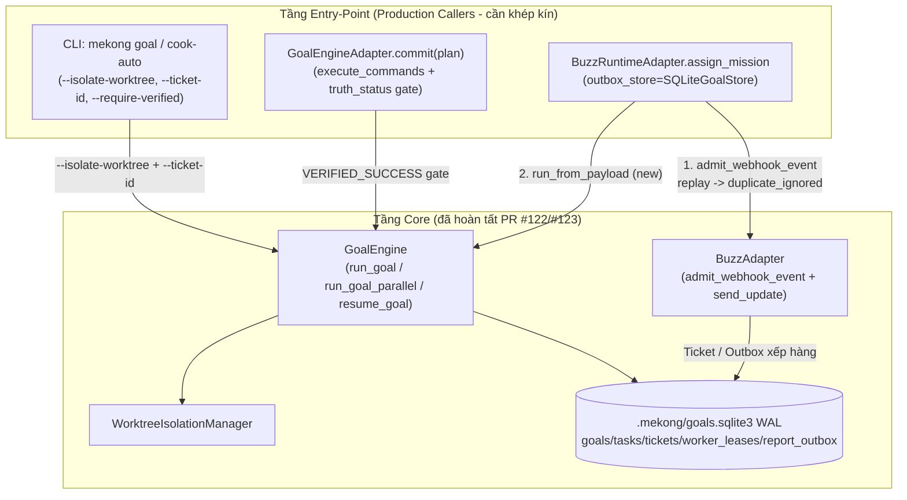

# Advisory Report — MEKONG CLI Supreme Command #01.1 (Production Caller & Operator Surface Convergence)

- **Document ID:** `MEKONG_SUPREME_COMMAND_01_1_E2E_WIRING_ADVISE`
- **Source Review:** PR [#122](https://github.com/minhlongs/mekong-cli/pull/122) (`a954f671e`) + PR [#123](https://github.com/minhlongs/mekong-cli/pull/123) (`20b9f14b2`) trên `origin/main`
- **Worktree:** `/Users/macbook/mekong-cli-autonomous-worktree` (`docs/autonomous-runtime-parity`)
- **Mode:** `/ak-advise --ultra` (Best-of-5 Verifier), kết quả: **Candidate B thắng — 77/80**
- **Ngôn ngữ:** Tiếng Việt (mã định danh kỹ thuật giữ nguyên tiếng Anh)

---

## 1. Verdict (Nhận định tổng quan)

`Supreme Command #01` đã hoàn thiện **100% tầng Core Primitives** (`ExecutionTruthStatus`, `SQLiteGoalStore` WAL, `ImmutableMandate` HMAC-SHA256, `WorkerLease` 2+1 lanes, `report_outbox`, `WorktreeIsolationManager`, `LocalExecutor(strict_mode=True)`, `Governance` fail-closed) với 20/20 kịch bản `T01–T20` xanh và 8/8 workflow `main` success.

Tuy nhiên, đúng nguyên tắc **"Done means it has a production caller"**, **3 điểm nối production caller vẫn đang bỏ qua hoặc che khuất các bất biến này**:

1. **Gap 1 — CLI & Adapter Truth Surface** (`src/cli/goal_commands.py`, `src/cli/cook_command.py`, `src/core/adapters/goal_engine_adapter.py`): output chỉ hiển thị `status="satisfied"`, hoàn toàn **không xuất `truth_status`** (`SIMULATED` vs `VERIFIED_SUCCESS` vs `UNAVAILABLE`); `GoalEngineAdapter.commit()` hardcode `execute_commands=False` nên luôn chạy mô phỏng nhưng vẫn trả `success=True`.

2. **Gap 2 — Buzz webhook bypass** (`src/core/buzz_runtime_adapter.py`): `__init__` khởi tạo `BuzzAdapter(transport=transport)` **không truyền `outbox_store`**; `assign_mission()` gọi thẳng `run_from_payload()` + `send_update()` **không qua `admit_webhook_event()`** — không chống replay `(source_id, event_id)`, không lưu `ImmutableMandate`, không xếp hàng `report_outbox` khi callback lỗi.

3. **Gap 3 — Missing CLI flags** (`src/cli/goal_commands.py`): `goal run` / `run-parallel` / `resume` thiếu `--isolate-worktree`, `--ticket-id`, `--require-verified`; `--workers` mặc định `3` trong khi `MAX_AUTONOMOUS_WORKERS = 2`.

---

## 2. Requirements (Yêu cầu chính xác — đã xác nhận với user)

1. **CLI Truth Surface:** `mekong goal run/status/verify --json` và `mekong cook-auto --json` luôn xuất `truth_status` và `simulated`.
2. **CLI Flags:** `goal run`, `run-parallel`, `resume` thêm `--isolate-worktree`, `--ticket-id`, `--require-verified`; mặc định `--workers = 2`.
3. **GoalEngineAdapter Explicit Dual Mode:** `execute_commands=True` bắt buộc `truth_status == VERIFIED_SUCCESS`; `execute_commands=False` giữ `success = (status == SATISFIED)` nhưng luôn gắn `metadata["truth_status"]` + `metadata["simulated"]`.
4. **BuzzRuntimeAdapter Replay + Outbox:** nhận `outbox_store: SQLiteGoalStore | None = None`; replay trùng trả `status="duplicate_ignored"`, `duplicate=True`; callback lỗi được xếp vào `report_outbox`.

**Non-goals:** Không đổi SQLite schema; không sửa `src/core/opencore/` hay `src/opc/`.
**Constraints:** Bất biến byte-for-byte `phase_559_opencore_25_step_catalog.py`; trần `<= 185 LOC` cho mọi module Open-Core/RaaS/OPC; **không làm gãy bất kỳ test hiện hữu nào**.

---

## 3. Done Means (Tiêu chí hoàn tất — kiểm chứng được)

- [ ] `mekong goal run <id> --json` / `goal_status --json` / `goal_verify --json` / `cook-auto --json` đều chứa `truth_status` + `simulated`.
- [ ] `goal run` & `run-parallel` nhận `--isolate-worktree`, `--ticket-id`, `--require-verified`; `--workers` mặc định `2`.
- [ ] `GoalEngineAdapter.commit(..., execute_commands=True)` trả `success=False` khi `truth_status != VERIFIED_SUCCESS`; metadata luôn có `truth_status`/`simulated`.
- [ ] `BuzzRuntimeAdapter(runtime=..., outbox_store=store).assign_mission(payload)` chặn replay trùng `(source_id, event_id)` (`status="duplicate_ignored"`, `duplicate=True`) và xếp callback lỗi vào `report_outbox`.
- [ ] `tests/test_autonomous_runtime_e2e_callers.py` + toàn bộ test hiện có xanh 100%.

---

## 4. Architecture Preview (Trạng thái đề xuất)



**So sánh output `mekong goal run --json` — Trước vs Sau:**

| Trường | Hiện tại (`main`) | Sau khi khép kín |
|---|---|---|
| `status` | `"satisfied"` | `"satisfied"` (giữ tương thích) |
| `truth_status` | *(thiếu)* | `"SIMULATED"` hoặc `"VERIFIED_SUCCESS"` |
| `simulated` | *(thiếu)* | `true` / `false` |
| `--isolate-worktree`, `--ticket-id`, `--require-verified` | *(không có)* | có mặt, `--workers` mặc định `2` |
| Buzz replay | chạy lại + callback trùng | `{"status": "duplicate_ignored", "duplicate": true, "ticket_id": "..."}` |

---

## 5. What you should do (Thứ tự thực thi)

### Step 1 — `src/mekongcli/core/goal_engine/service.py` (nền móng cho flag)

- Thêm `isolate_worktree: bool = False` vào `GoalEngine.run_goal()` (dòng `78-85`), dùng chung đường chạy worktree với `run_goal_parallel()` (dòng `359-373`): `self.worktree_manager.allocate(ticket_id or goal.id, task.id)` trong `try ... finally: cleanup(wt_path)`.
- Thêm `ticket_id: str | None = None, isolate_worktree: bool = False` vào `resume_goal()` (dòng `551-557`) và chuyển tiếp xuống `self.run_goal(...)`.

> Khuyến nghị DRY từ Candidate D: đặt đường chạy worktree vào một helper nội bộ (ví dụ `_run_task_with_optional_worktree(...)`) để `run_goal` và `run_goal_parallel` dùng đúng một đoạn code.

### Step 2 — `src/core/adapters/goal_engine_adapter.py` (Explicit Dual Mode)

- `__init__` và `make_goal_engine_adapter()` nhận thêm `execute_commands: bool = False`, `isolate_worktree: bool = False`.
- Trong `commit(plan)` (dòng `100-147`):
  - Đọc override từ `plan.metadata`: `execute_commands`, `isolate_worktree`, `ticket_id`, `verification_profile`.
  - **Chỉ truyền kwargs mở rộng khi chữ ký hỗ trợ** — `inspect.signature(self._service.run_goal).parameters` (xem bẫy §7.3).
  - Chuẩn hóa `truth_status` an toàn (enum thật vs `MagicMock`), tính `simulated`.
  - `execute_commands=True` → `success = (status == SATISFIED and truth_status == VERIFIED_SUCCESS)`; nếu không, `error = f"Goal did not achieve VERIFIED_SUCCESS (truth_status={truth_val})"`.
  - `execute_commands=False` → `success = (status == SATISFIED)` nhưng luôn gán `metadata["truth_status"]`, `metadata["simulated"]`, `metadata["execute_commands"]`, `metadata["isolate_worktree"]` và `output["goal_truth_status"]`.

### Step 3 — `src/core/buzz_adapter.py` + `src/core/buzz_runtime_adapter.py` (Replay + Outbox)

- **`BuzzAdapter.admit_webhook_event(self, payload, *, source_id=None) -> tuple[TicketRecord, bool]`** (hàm **chưa tồn tại**, hiện chỉ có `receive_goal`/`send_update`):
  - Nếu `self._outbox_store is None` → raise `BuzzConfigError`.
  - `event_id = str(payload.get("event_id") or payload.get("mission_id") or "").strip()`; nếu rỗng → raise `ValueError`.
  - `ticket_id` tất định: `payload.get("ticket_id") or f"tkt_{sha256(f'{source_id}:{event_id}')[:12]}"`.
  - Xây `ImmutableMandate` fail-closed (`risk_classification` mặc định `"LOW"`, `cost_budget` mặc định `5.0`, `retry_budget` `3`) → gọi `self._outbox_store.admit_ticket(...)`.
  - Trả `(TicketRecord(...), created)` với `created = not bool(admitted.get("deduplicated"))`.
- **`BuzzRuntimeAdapter.__init__`** (dòng `56-68`): thêm `outbox_store: SQLiteGoalStore | None = None`, lưu `self._outbox_store`, truyền xuống `BuzzAdapter(transport=transport, outbox_store=outbox_store)`.
- **`BuzzRuntimeAdapter.assign_mission`** (dòng `118-169`):
  - Nếu `self._outbox_store is not None` và payload có `event_id`/`mission_id`: gọi `self._buzz.admit_webhook_event(payload)`.
  - `created is False` → **không** `start_mission()`, **không** `run_from_payload()`, **không** `send_update()`; trả ngay `{"status": "duplicate_ignored", "duplicate": True, "ticket_id": ticket.ticket_id, ...}`.
  - `created is True` → chạy mission, rồi `send_update(..., ticket_id=..., source_id=..., thread_id=..., idempotency_key=f"{source_id}:{ticket_id}:{outcome}")` để lỗi transport rơi vào `report_outbox` (`FAILED_RETRYABLE` → `DEAD_LETTER`).
  - Gắn `ticket_id`, `outbox_id`, `delivery_status` vào dict trả về (Observability — Candidate E).

### Step 4 — `src/cli/goal_commands.py` + `src/cli/cook_command.py` (Truth Surface)

- **`_goal_result_payload()`** (dòng `49-70`): tận dụng một lần `engine.status(goal_id)`, xuất thêm `"truth_status"` và `"simulated"`.
- **`_cook_auto_payload()`** (`cook_command.py:210-246`): **phải** đọc an toàn `snapshot.get("goal", {})` (xem bẫy §7.5), xuất `"truth_status"`, `"simulated"`; hiển thị `Truth Status` trong `_cook_auto_panel_body()`.
- **Flags:** thêm `--isolate-worktree`, `--ticket-id`, `--require-verified` vào `goal_run`, `goal_run_parallel`, `goal_resume`; thêm `--execute-commands` vào `goal_resume`; đổi `--workers` mặc định `3` → `2` ở `goal_run_parallel` (`:150`) và `cook_auto_parallel` (`:450`).
- **Exit gate dùng chung** (DRY — Candidate D): một helper `_should_exit_nonzero(goal, require_verified)` thay cho khối lặp 6 chỗ; điều kiện là `goal.status != GoalStatus.SATISFIED` **hoặc** (`require_verified` và `goal.truth_status != ExecutionTruthStatus.VERIFIED_SUCCESS`) — kiểm tra **trước khi return** ở nhánh `--json`.
- **Sửa 2 lỗi thoát sớm:** `goal_run_parallel` (`:172-174`) và `goal_verify` (`:239-247`) hiện `return` ở nhánh `--json` mà **bỏ qua** kiểm tra `SATISFIED`; dòng `244-247` là dead code.

### Step 5 — `tests/test_autonomous_runtime_e2e_callers.py` (E2E khóa hợp đồng)

Bốn nhóm test:
1. CLI JSON truth surface (`SIMULATED`, `simulated=True` ở chế độ mặc định; `--require-verified` → exit code `1`).
2. `--isolate-worktree`, `--ticket-id`, `--workers` mặc định `2`.
3. `GoalEngineAdapter.commit()` cả 2 chế độ (`profile="none"` → `UNAVAILABLE` → `success=False`).
4. `BuzzRuntimeAdapter` replay dedup + `report_outbox` khi transport trả `503`.

---

## 6. Benefits

- **Chấm dứt "false-positive green" ở mọi entry point:** không còn `status="satisfied"` / `success=True` che giấu `SIMULATED`.
- **Chống replay + at-least-once delivery end-to-end** cho Buzz webhook (`UNIQUE(source_id, event_id)` + `report_outbox`).
- **Bền vững toolbar:** `--require-verified` cho CI/CD phân biệt tức thì chạy thật và mô phỏng.
- **Tương thích ngược 100%** — không test hiện hữu nào phải sửa.

---

## 7. What you shouldn't do (Bẫy đã xác minh trên HEAD)

1. **Không** đổi `phase_559_opencore_25_step_catalog.py`, không sửa `src/core/opencore/`, `src/core/raas_license_verifier.py`, `src/opc/`, không đổi schema SQLite trong `store.py`.
2. **Không** lật mặc định `execute_commands` sang `True` (gãy `tests/test_goal_engine_adapter.py`, `tests/ports/test_goal_engine_conformance.py`, `tests/mekongcli/test_goal_cli.py`).
3. **Không** truyền mù `isolate_worktree=` / `ticket_id=` vào `self._service.run_goal(...)`: `StubGoalEngineService.run_goal` tại `tests/test_goal_engine_adapter.py:60-65` có chữ ký cố định 3 tham số (**không có `**kwargs`**) → `TypeError`. Dùng `inspect.signature(...)` hoặc chỉ truyền khi khác mặc định.
4. **Không** giả định `completed_goal.truth_status` là enum: stub trả `MagicMock()` → `.value` là `MagicMock`, phá JSON. Kiểm tra `isinstance(..., ExecutionTruthStatus)` trước.
5. **Không** viết `snapshot["goal"]["truth_status"]` trong `_cook_auto_payload`: `tests/mekongcli/test_goal_cli.py:211` (`test_cook_auto_payload_reports_failed_required_gates`) truyền `snapshot` **không có khóa `"goal"`** → `KeyError`. Bắt buộc `snapshot.get("goal") or {}`.
6. **Không** bắt buộc `outbox_store` khác `None`: `tests/test_buzz_transport.py` khởi tạo `BuzzRuntimeAdapter(runtime=..., tracer=..., transport=...)` không có store.
7. **Không** import `BuzzAdapter` ở module-level của `runtime_adapter.py` — `tests/test_core_boundary.py` quét AST nghiêm ngặt.
8. **Không** để `admit_webhook_event` nhận payload không hợp lệ (thiếu `goal`) làm ô nhiễm bảng `tickets` trước khi `receive_goal()` từ chối.
9. **Không** xóa/đổi tên khóa JSON hiện có trong `_goal_result_payload`/`_cook_auto_payload` — chỉ **bổ sung thêm**.
10. **Không** sinh `idempotency_key` không tất định (`uuid4`/timestamp) — phá `UNIQUE(idempotency_key)` của `report_outbox`.

---

## 8. Trade-offs

- **Mặc định `execute_commands=False`:** đổi lại là caller không tường minh vẫn nhận `success=True` với `SIMULATED`. Giảm thiểu bằng metadata `truth_status`/`simulated` luôn hiện diện + cờ `--require-verified`. **Điều kiện chuyển sang strict default:** khi mọi test kế thừa đã trả tường minh trạng thái mô phỏng, có thể đảo mặc định `--require-verified`/`execute_commands` sang `True`.
- **Chi phí `inspect.signature`** trong `commit()`: ~vài micro-giây mỗi lần gọi — đổi lại không phải sửa test stub cũ.
- **I/O worktree:** mỗi task thêm ~30–150 ms khi bật `--isolate-worktree`; mặc định tắt nên không ảnh hưởng đường chạy hiện tại.
- **JSON thêm 2 khóa:** additive; test hiện tại đọc theo từng khóa nên an toàn.

---

## 9. Work Checklist, Success Metrics & Handoff Brief

### Work Checklist
- [ ] `src/mekongcli/core/goal_engine/service.py`: `isolate_worktree` trên `run_goal()`, `ticket_id` + `isolate_worktree` trên `resume_goal()`; DRY helper worktree dùng cho cả tuần tự và song song.
- [ ] `src/cli/goal_commands.py`: xuất `truth_status`/`simulated`; thêm `--isolate-worktree`, `--ticket-id`, `--require-verified` trên `goal run`/`run-parallel`/`resume` + `--require-verified` trên `goal verify`; `--workers` mặc định `2`; sửa exit-code bug nhánh `--json` của `goal_run_parallel` và `goal_verify`; helper `_should_exit_nonzero` dùng chung.
- [ ] `src/cli/cook_command.py`: xuất `truth_status`/`simulated` trong `_cook_auto_payload` (đọc `snapshot.get("goal", {})`) và `cook --json`; `--workers` mặc định `2`.
- [ ] `src/core/adapters/goal_engine_adapter.py`: `execute_commands` + `isolate_worktree` cho `__init__`/`make_goal_engine_adapter`; override qua `plan.metadata`; `inspect.signature` guard; Explicit Dual Mode; metadata/output luôn có `truth_status` + `simulated`.
- [ ] `src/core/buzz_adapter.py`: thêm `admit_webhook_event(payload, *, source_id=None) -> tuple[TicketRecord, bool]` (mandate tất định + `admit_ticket`).
- [ ] `src/core/buzz_runtime_adapter.py`: `outbox_store` param; replay short-circuit `duplicate_ignored`; `send_update(..., ticket_id=, idempotency_key=)`; trả `ticket_id`/`outbox_id`/`delivery_status`.
- [ ] `tests/test_autonomous_runtime_e2e_callers.py`: E2E 4 nhóm nêu trên.
- [ ] `docs/buzz-runtime-adapter.md`, `docs/runtime-adapters.md`, `docs/core-contract.md`: parity cho `outbox_store`, replay dedup, `report_outbox`, `--isolate-worktree`/`--require-verified`.

### Success Metrics (kiểm chứng bằng lệnh)
```bash
# 1. E2E + trust matrix + CLI/adapter/conformance/transport
python3 -m pytest \
  tests/test_autonomous_runtime_e2e_callers.py \
  tests/test_autonomous_runtime_trust_matrix.py \
  tests/mekongcli/test_goal_cli.py \
  tests/mekongcli/test_goal_engine.py \
  tests/test_goal_engine_adapter.py \
  tests/ports/test_goal_engine_conformance.py \
  tests/test_buzz_adapter.py tests/test_buzz_transport.py \
  tests/test_cook_e2e_lifecycle.py -v   # phải 100% PASS

# 2. Open-Core / RaaS / boundary gate
python3 -m pytest \
  tests/test_opencore_saas_25_step_suite.py tests/test_core_boundary.py \
  tests/test_dual_rail_checkout.py tests/test_raas_license_verifier.py \
  tests/test_durian_grab_honest_diagnosis.py \
  tests/test_idea_run_blueprint_writing.py \
  tests/test_opencore_git_boundary_guard.py \
  tests/test_github_content_25_step_sync.py -v   # phải 100% PASS

# 3. Trần <= 185 LOC + vùng cấm không đổi
python3 -c "from pathlib import Path;[print(f'{p}: {len(p.read_text().splitlines())} LOC') or (lambda n: (_ for _ in ()).throw(AssertionError(f'{p} = {n} > 185')) if n > 185 else None)(len(p.read_text().splitlines())) for p in [*Path('src/core/opencore').glob('*.py'), Path('src/core/raas_license_verifier.py'), *Path('src/opc').glob('*.py')]]; print('LOC gate passed')"
git diff --exit-code src/core/opencore/ src/opc/

# 4. Lint
python3 -m ruff check src/cli/goal_commands.py src/cli/cook_command.py \
  src/core/adapters/goal_engine_adapter.py src/core/buzz_adapter.py \
  src/core/buzz_runtime_adapter.py \
  src/mekongcli/core/goal_engine/service.py \
  tests/test_autonomous_runtime_e2e_callers.py
```

### Handoff Brief
```yaml
Handoff brief:
  Problem: >
    Close the 3 production-caller wiring gaps left after Supreme Command #01 (PR #122/#123)
    across CLI commands (goal_commands.py, cook_command.py), GoalEngineAdapter, and
    BuzzRuntimeAdapter so no entry point hides SIMULATED execution state or bypasses
    SQLiteGoalStore webhook replay deduplication and report_outbox durability.
  Chosen direction: >
    Bottom-up seam wiring with Explicit Dual Mode on GoalEngineAdapter (execute_commands
    and isolate_worktree configurable via constructor and plan.metadata), full truth_status
    and simulated telemetry + --isolate-worktree/--ticket-id/--require-verified flags on CLI
    commands (--workers default 2, one shared _should_exit_nonzero gate fixing the --json
    early-return bug), and outbox_store: SQLiteGoalStore | None = None wired through
    BuzzRuntimeAdapter + new BuzzAdapter.admit_webhook_event().
  Files to modify:
    - src/mekongcli/core/goal_engine/service.py
    - src/cli/goal_commands.py
    - src/cli/cook_command.py
    - src/core/adapters/goal_engine_adapter.py
    - src/core/buzz_adapter.py
    - src/core/buzz_runtime_adapter.py
    - tests/test_autonomous_runtime_e2e_callers.py (new)
    - docs/buzz-runtime-adapter.md, docs/runtime-adapters.md, docs/core-contract.md
  Protected invariants:
    - Never touch src/core/opencore/phase_559_opencore_25_step_catalog.py, src/core/opencore/*,
      src/core/raas_license_verifier.py, or src/opc/* (<= 185 LOC ceiling preserved).
    - Never change the SQLite schema in src/mekongcli/core/goal_engine/store.py.
    - StubGoalEngineService.run_goal in tests/test_goal_engine_adapter.py has a fixed 3-arg
      signature (no **kwargs) and returns MagicMock() without truth_status — guard with
      inspect.signature and isinstance(ExecutionTruthStatus) checks.
    - tests/mekongcli/test_goal_cli.py:211 passes a snapshot without a "goal" key — read with
      snapshot.get("goal") or {}.
    - Keep outbox_store optional (None default) in BuzzRuntimeAdapter for backward compatibility.
  Done means:
    - "mekong goal run/status/verify --json" and "mekong cook-auto --json" emit truth_status and simulated
    - "mekong goal run" and "run-parallel" expose --isolate-worktree, --ticket-id, --require-verified with --workers default 2
    - "GoalEngineAdapter.commit(execute_commands=True)" requires truth_status == VERIFIED_SUCCESS and always records truth_status/simulated in metadata
    - "BuzzRuntimeAdapter.assign_mission()" skips duplicate (source_id, event_id) replays (status="duplicate_ignored", duplicate=True) and queues failed callbacks into report_outbox
    - tests/test_autonomous_runtime_e2e_callers.py plus every existing test passes 100%
  Stop and ask only if:
    - SQLiteGoalStore.admit_ticket() or TicketRecord/ImmutableMandate shapes differ from the
      signatures assumed here (verified on HEAD for Candidate B's target lines — re-check before coding)
    - a test regression cannot be fixed within the confirmed scope
```

---

## 10. Ranking Appendix (`--ultra` Best-of-5)

| Candidate | Faithfulness | Evidence | Trade-offs | Actionability | **Total** |
|---|---:|---:|---:|---:|---:|
| **B (winner)** | 20 | 19 | 19 | 19 | **77/80** |
| C | 19 | 19 | 18 | 18 | 74/80 |
| D | 19 | 18 | 18 | 19 | 74/80 |
| E | 19 | 17 | 18 | 20 | 74/80 |
| A | 19 | 17 | 17 | 18 | 71/80 |

Hợp nhất từ á quân: (C) bẫy `snapshot` thiếu khóa `"goal"` tại `tests/mekongcli/test_goal_cli.py:211` + `ticket_id`/`idempotency_key` SHA-256 tất định; (D) helper DRY `_should_exit_nonzero` + đường dẫn test thực tế trên đĩa; (E) `outbox_id`/`delivery_status` trong kết quả trả về + lệnh kiểm tra trần `<= 185 LOC`.

---

*Advisory only — báo cáo này không thay đổi mã nguồn. Tiếp theo: `/ak:plan` hoặc `/ak:fix` với brief phía trên.*
